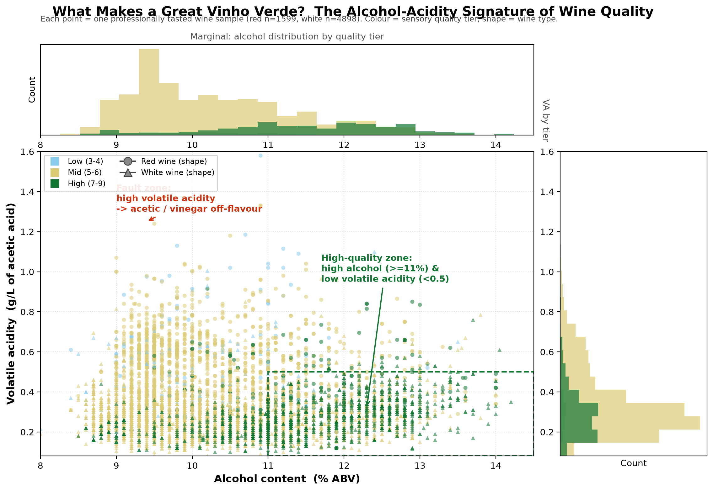

# ZHANG JIALEI — Data Science Portfolio

> University of Macau · CISC7204 Personal Learning Forum of Practice 09
> GitHub: [@zjlupupgo](https://github.com/zjlupupgo)

## Introduction

I am a first-year MSc student at the University of Macau with a growing interest
in data science, statistical analysis, and data storytelling. This portfolio
collects the data-analysis projects I build during my studies, each documented
so that the work is reproducible and the findings are easy to understand.

## Technical Skills

- **Languages:** Python (pandas, NumPy, matplotlib, SciPy), SQL (basics)
- **Methods:** Exploratory data analysis, correlation analysis, data
  visualization, statistical summarization
- **Tools:** Git & GitHub, Jupyter Notebook, GitHub Pages
- **Currently learning:** Machine learning, predictive modelling, dashboarding

## Project Showcase

### 🍷 Wine Quality Analysis — Vinho Verde

**Research question:** *Which physicochemical features are most strongly
associated with higher (or lower) sensory quality in red and white Vinho Verde
wines, and what does the "signature" of a high-quality wine look like?*

**Key finding:** Alcohol content is the strongest positive driver of quality for
both red (*r* = +0.48) and white (*r* = +0.44) wines, while volatile acidity
hurts red wine most (*r* = −0.39). High-quality wines form a clear "high-quality
zone" — higher alcohol (≥ 11% ABV) and lower volatile acidity (< 0.5 g/L).

**Repository:** [data-science-project](https://github.com/zjlupupgo/data-science-project)

**Status:** ✅ Completed (exploratory analysis; no predictive model yet)

---

## More soon

Additional projects (e.g., predictive modelling on this dataset) will be added
as they are completed.
